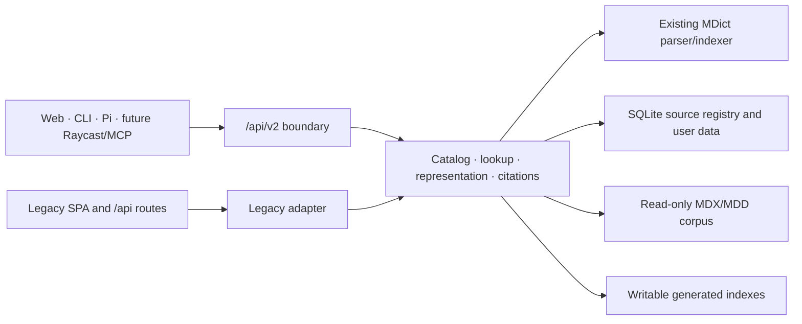

## Context

See [proposal.md](./proposal.md) for motivation and scope. The current repository already has three valuable layers: an MDict parser/indexer, Flask routes that rewrite dictionary resources, and a React reader. The v2 foundation must introduce a stable service boundary without replacing those layers prematurely.

Current evidence that shapes the design:

- `flask_mdict/api.py` duplicates lookup and HTML-rewrite logic across per-source and aggregate routes, returns raw HTML, mutates history on GET, reflects any CORS origin, and has no authentication.
- `flask_mdict/helper.py` derives dictionary UUIDs from absolute paths and writes application data, generated indexes, and `about_*.html` beside the corpus.
- `app.py` applies `ProxyFix` to every request without an explicit trust boundary and contains a fixed default secret.
- The React client renders dictionary scripts in a `srcDoc` iframe with both `allow-scripts` and `allow-same-origin`.
- The accepted v2 interface prototype preserves four visibly different source documents inside one reference workspace; browser checks confirmed automatic frame sizing, phone reflow, source-link messaging, and a dark shell around unchanged light source documents without console errors or warnings.
- A read-only extraction of the real OALD 10 `right` record measured 206,902 bytes, 4,075 tags, depth 14, 88 distinct classes, 291 IDs, one table, 200 entry links, 206 sound links, one source script, and 35 inline handlers. After making the source script and handlers inert, the original CSS rendered successfully in the opaque frame at desktop and phone widths; real entry and audio actions reached only the typed bridge, and the browser console remained clean.
- Docker, Compose, Unraid packaging, optional Valkey caching, and the existing React production build already work and should remain viable.
- Pi 0.82.1 supports installable packages containing TypeScript extensions and skills, so it can consume a normal HTTP tool contract without becoming part of the server.

The behavior contracts live under [specs/](./specs/).

## Goals / Non-Goals

**Goals:**

- Establish one internal lookup service used by both v2 and legacy adapters.
- Make source identity and citations independent of absolute mount paths.
- Keep dictionary content renderable while producing bounded, safe machine evidence.
- Deliver the accepted browser reading workspace without normalizing arbitrary lexicon HTML or CSS.
- Fail closed for private API access and keep proxy/origin trust explicit.
- Make a read-only corpus the normal deployment shape.
- Deliver a dependency-light CLI and an optional Pi package against published contracts.
- Preserve legacy response shapes until downstream clients migrate.

**Non-Goals:**

- Normalizing arbitrary dictionary markup into one universal lexical ontology.
- Retaining historical dictionary revisions after their files are removed.
- Executing untrusted dictionary JavaScript in the authenticated application origin.
- Providing model inference, provider routing, or BYOK storage in the Flask service.
- Solving multi-user authorization, public exposure, or distributed data synchronization.

## Decisions

### 1. Introduce an internal service layer before adding routes

Create a catalog, lookup service, representation pipeline, and citation resolver that return Python domain records without Flask response objects. The new v2 blueprint serializes those records; legacy routes adapt the same records into their existing shapes.



This removes the current duplicated lookup loops while leaving parsing behavior intact. A second standalone service or parser rewrite was rejected because it would increase migration risk without improving the contract.

### 2. Use an enveloped `/api/v2` contract

Successful responses use:

```json
{
  "api_version": "2.0",
  "request_id": "req_...",
  "data": {}
}
```

Errors use:

```json
{
  "api_version": "2.0",
  "request_id": "req_...",
  "error": {
    "code": "invalid_query",
    "message": "Query is not valid.",
    "details": { "query": "Maximum length is 256 characters." }
  }
}
```

Initial routes:

| Method | Route | Purpose |
|---|---|---|
| `GET` | `/health/live` | Minimal unauthenticated liveness |
| `GET` | `/health/ready` | Minimal unauthenticated readiness |
| `GET` | `/assets/v2/{capability}` | Short-lived signed dictionary resource |
| `GET` | `/api/v2` | Authenticated discovery |
| `GET` | `/api/v2/status` | Authenticated diagnostic status |
| `GET` | `/api/v2/sources` | Source discovery |
| `PATCH` | `/api/v2/sources/{source_id}` | Source enablement and ordering |
| `GET` or `POST` | `/api/v2/lookup` | Bounded lookup; GET uses `q`, POST uses JSON |
| `GET` | `/api/v2/suggestions` | Prefix and optional fuzzy candidates |
| `GET` | `/api/v2/metadata` | Structured lexical metadata |
| `GET` | `/api/v2/citations/{citation_token}` | Resolve an opaque citation |

Query text moves out of path segments so phrases, slashes, and Unicode behave consistently. OpenAPI 3.1 and JSON tool schemas are checked into `contracts/`; runtime documentation generators are unnecessary.

### 3. Keep source identity stable through a registry

Add a `source_registry` table in the application database with at least `source_id`, full content `revision`, last known relative path, title, creation time, and last-seen time.

Discovery calculates a SHA-256 revision over the MDX digest and an ordered manifest of associated MDD relative filenames and digests. The primary `<name>.mdd` and files matching `<name>.*.mdd` are associated case-insensitively and ordered by normalized relative filename. Every startup or explicit rescan verifies full file bytes; size, modification time, inode, and ctime may avoid duplicate hashing only within the same active scan, never across discovery cycles.

Matching order is:

1. Exact content revision whose prior path is absent from the current scan: reuse the existing `source_id`, including after a path move.
2. Known relative path with changed content: preserve `source_id` and advance `revision`.
3. Otherwise: assign a new random opaque `source_id`.

If an identical revision is simultaneously present at multiple paths, each present copy receives a distinct `source_id`; revision equality does not collapse a deliberate duplicate. Moving and changing a source in the same discovery cycle may produce a new `source_id`; that conservative ambiguity is preferable to merging unrelated dictionaries. Absolute paths remain internal and never appear in responses or citations.

The current path-derived UUID remains available only as a legacy alias while old routes exist.

### 4. Make citations revision-specific and opaque

A citation URI has the conceptual form:

```text
mdict://<source_id>/<revision>/<representation_version>/<entry_id>#<block_id>
```

Clients treat it as opaque. Headwords are normalized to NFC with surrounding Unicode whitespace removed; punctuation and internal whitespace remain significant. `entry_id` is derived from that normalized headword, source record ordinal, and record content hash. Text blocks use ordered IDs plus a text hash. `representation_version` advances whenever incompatible normalization or extraction would change entry/block identity. The HTTP resolver receives a base64url citation token protected by an HMAC so the URI never becomes an unsafe path or forgeable selector.

The service retains registry metadata and decoders for supported representation versions, but not old dictionary bytes. A citation resolves while its revision is mounted and its representation version is supported; otherwise the resolver returns `410 Gone`. Retaining full historical dictionaries was rejected because it would silently turn MdictLive into a corpus versioning and storage product.

### 5. Produce safe render HTML and text from one record pipeline

The representation pipeline performs these stages once per source record:

1. Resolve MDict link indirections.
2. Repair only the minimal malformed markup already handled by the parser layer.
3. Rewrite images, fonts, stylesheets, sounds, and entry links to source-scoped URLs. Resource URLs carry a short-lived HMAC capability scoped to source, revision, normalized resource path, and expiry; nested URLs inside served CSS are rewritten the same way. The bearer token never appears in an asset URL.
4. Produce safe render HTML with scripts, inline event handlers, `javascript:` URLs, and unsafe embedding elements made inert.
5. Extract ordered visible-text blocks, excluding scripts, styles, navigation noise, and non-content metadata.
6. Attach entry and block citations, then apply response bounds.

Use a pure-Python tolerant HTML parser such as Beautiful Soup with the standard parser first; add a native parser only if corpus fixtures show a measurable need. CSS and packaged media remain available through signed resource capabilities whose default lifetime is five minutes; resolving the entry again produces fresh URLs. Script execution can be revisited later only through an isolated renderer origin or explicit trusted-source design.

The alternatives were rejected as follows:

- Returning raw HTML only leaves agents unreliable and exposes clients to executable content.
- Sanitizing into a universal schema destroys dictionary-specific structure.
- Executing scripts in the main origin preserves edge-case dictionaries at an unacceptable trust cost.

#### Browser rendering boundary

Safe render HTML remains a source-owned document, not input to a universal React definition component. The browser wraps each returned entry with application-owned source identity, citation, status, and navigation controls, then renders the entry in a sandboxed iframe whose origin remains opaque. The sandbox may grant `allow-scripts` only for an application-owned bridge injected after dictionary scripts and handlers are removed; it never grants `allow-same-origin` in the default renderer.

The bridge supports only typed content-height, rewritten entry-link, sound, and explicitly supported media messages. The parent correlates every message with the expected frame window and an unguessable per-render capability before acting. Arbitrary navigation, evaluation, storage access, generic RPC, and credential forwarding are not bridge capabilities. If the bridge fails, the entry remains readable through a bounded internal surface or a dedicated safe-source view.

Workspace CSS and theme tokens stop at the frame boundary. A dark workspace does not generically invert or recolor a light dictionary; source-owned colors, fonts, tables, and selector behavior remain authoritative. A dictionary-specific dark theme or curated reading adapter is allowed only as an explicit tested source capability, never as the default normalization path.

The application may show structured metadata, a quick sense, and contextual agent guidance outside native source documents. Those surfaces name their dataset or citations and cannot masquerade as dictionary-authored evidence. A dedicated full-source view reuses the same sanitized representation and resource capabilities rather than exposing unsanitized raw HTML.

### 6. Bound every expensive dimension

Defaults are conservative and configurable:

- Query: 256 Unicode scalar values.
- Selected sources: 32.
- Returned entries: 50.
- Extracted text: 64 KiB per response and 24 KiB per entry.
- Render HTML: 4 MiB per response.
- Suggestions: 20 by default, 100 maximum.
- Agent tool evidence: 32 KiB by default.

Responses report applied limits, truncation causes, elapsed time, completed and failed source IDs, and source IDs omitted by bounds. Truncation occurs only between complete entries or complete text blocks. A fixed-size executor may isolate source lookups and report a configured per-source timeout; its queue and workers remain bounded so abandoned slow reads cannot grow without limit. Source adapters must not reuse Flask request-local SQLite connections across workers. If every selected source fails, the boundary returns `503 lookup_unavailable`; any completed source yields HTTP 200 with `partial` reflecting the failures, even when no entry matched.

Cache keys include API schema version, source revision, normalized query, selected sources, requested representations, and applied bounds. Authentication credentials never enter cache keys or values.

### 7. Use headword indexes for fallback, not definition-body indexing

Exact lookup remains the primary path. Prefix suggestions reuse the existing MDict key indexes. Fuzzy fallback is explicit and runs only after no exact match, over a bounded candidate set selected by prefix/length before ranking. A pure-Python ranker is sufficient initially; a new native search dependency requires benchmark evidence.

This avoids a long startup, large secondary index, and unclear relevance model. Definition-body full-text search remains a separate future capability.

The existing ECDICT-derived frequency database remains an optional metadata dataset. Metadata responses name that dataset and do not present its definitions/translations as extracted MDict evidence. Query input is trimmed and normalized to NFC; punctuation and internal whitespace remain significant. Source adapters retain their declared case-sensitive or case-insensitive lookup behavior.

### 8. Authenticate v2 with one bearer token

Read the token from `MDICT_LIVE_TOKEN` or `MDICT_LIVE_TOKEN_FILE`; file input is preferred in container secret systems. Compare with `hmac.compare_digest`. All `/api/v2` routes require `Authorization: Bearer`. Health routes live outside `/api/v2`; `/assets/v2` authorizes only a short-lived signed capability and cannot enumerate or resolve arbitrary resources.

The service refuses to enable v2 on any bind, including loopback, when no token is configured. Signed resource capabilities use HMAC-SHA256 with a purpose-separated signing key derived from the bearer secret unless a separate signing-key file is configured; rotating the token/signing key invalidates outstanding capabilities after restart. Token values are redacted from logs, diagnostics, URLs, exception messages, and tool/model context.

Legacy routes remain available for the current SPA in this change and are not retrofitted with bearer authentication. Therefore any deployment that serves them must keep the entire origin behind Tailscale, ZeroTier, LAN controls, or an equivalent private boundary. Direct public-Internet exposure is unsupported even if a reverse proxy protects v2 paths.

No account database, refresh token, OAuth flow, or model-provider credential store is added. Those would solve a different product problem.

### 9. Disable CORS by default and configure proxy trust

CLI and agent calls normally omit `Origin` and need no CORS headers. Browser cross-origin access uses an exact allowlist from `MDICT_CORS_ORIGINS`; wildcard-plus-credentials is never emitted.

Generated API/resource links are relative wherever possible. `MDICT_TRUSTED_PROXY_HOPS` declares the exact hop count and `MDICT_TRUSTED_PROXY_CIDRS` optionally narrows accepted proxy addresses; both are disabled by default. Forwarded headers are processed only inside that boundary. Requests outside it have forwarded headers stripped before `ProxyFix` runs. Trusting all forwarded headers, as the current app does, was rejected because direct clients can spoof external scheme, host, and address. Nginx Proxy Manager terminates TLS, forwards one trusted hop in the documented topology, and is reachable only through the private network; Tailscale/ZeroTier peers are clients, not implicitly trusted header-writing proxies.

### 10. Separate corpus, state, and indexes

Canonical paths are:

```text
/library                 read-only MDX/MDD corpus
/data/mdict-live.db      writable history, wordbooks, settings, registry
/data/index/             writable generated MDX/MDD indexes
/config/                 optional non-secret configuration
```

Equivalent local paths are configurable through `MDICT_LIBRARY_DIR`, `MDICT_DATA_DIR`, and `MDICT_INDEX_DIR`. The parser must never create `about_*.html` or index databases under `/library`.

On first v2 startup, a migration transaction:

1. Locates the legacy `flask_mdict.db` only when the v2 data database is absent.
2. Copies it to a temporary data-path file.
3. Runs SQLite integrity and schema migration checks.
4. Atomically renames it into place.
5. Optionally copies reusable legacy indexes; failure falls back to rebuilding under `/data/index`.
6. Records a migration event without deleting or modifying legacy files.

If `/data/mdict-live.db` already exists, it is authoritative and legacy state is neither merged nor overwritten. An index-copy failure is non-fatal because indexes are disposable and rebuildable; database integrity, schema, permission, or atomic-copy failures are fatal. Legacy routes use the migrated application database so there is one writable state after cutover.

### 11. Build the CLI as a small Python package

Place the client in a separately installable package with a `pyproject.toml` entry point named `mdict-live`. Use Python 3.11 standard-library `argparse`, `urllib`, `json`, and `tomllib` unless tests expose a concrete reason for another dependency. A local profile still calls an HTTP service; the CLI never opens MDX files directly.

Profiles store URL and defaults in `${MDICT_LIVE_CONFIG}`, `$XDG_CONFIG_HOME/mdict-live/config.toml` (falling back to `~/.config/mdict-live/config.toml`) on Unix-like systems, or `%APPDATA%\\mdict-live\\config.toml` on Windows. The file names `default_profile`; each `[profiles.<name>]` table may contain `url`, `token_file`, `timeout_seconds`, and default source selectors. Token values do not belong in TOML. Tokens resolve from `--token` (discouraged because shell/process lists may expose it), `MDICT_LIVE_TOKEN`, or `--token-file`/the profile token-file reference.

Global options are `--profile`, `--url`, `--token`, `--token-file`, `--timeout`, `--json`, `--agent`, and `--verbose`. The CLI supports `health [--details]`, `sources`, `lookup <query> [--source ...] [--record-history]`, `resolve <citation-or-token>`, and `suggest <prefix> [--fuzzy]`. Minimal health calls do not resolve a token; `health --details` does. `record_history` is sent only through POST lookup.

Documented exit codes:

| Code | Meaning |
|---:|---|
| `0` | Complete success with a match or successful non-lookup command |
| `1` | Completed lookup with no match |
| `2` | Usage, configuration, or local validation error |
| `3` | Authentication error |
| `4` | Transport or timeout error |
| `5` | Client/server contract incompatibility |
| `6` | Server rejected a validly transported request |
| `7` | Partial lookup, with or without matched entries |

Exit classification precedence is local validation (`2`), authentication (`3`), transport (`4`), compatibility (`5`), other server rejection (`6`), partial (`7`), complete no-match (`1`), then complete success (`0`). A complete but truncated response is successful and uses `0`. Machine modes keep stdout clean and diagnostics go to stderr. `--json` emits exactly one client envelope for every handled outcome, including local and transport failures; outside JSON mode transport failures leave stdout empty.

### 12. Publish agent schemas and implement Pi as an adapter

`contracts/agent-tools-v1.json` defines four read-only tools: source listing, lookup, citation resolution, and suggestions. They map directly to v2 requests and contain bounded text evidence rather than HTML.

The Pi package contains:

- A TypeScript extension registering those tools with Pi.
- A skill that instructs the agent to compare sources, separate evidence from inference, cite lexical claims, label generated examples, and state when evidence is insufficient.
- Transport configuration for the MdictLive URL and token that never enters tool results or model context.

Pi's active model/provider remains host-owned. A sub2api-routed GPT-5.6 Luna or Sonnet 5 works because Pi already speaks compatible provider protocols; the MdictLive package contains no provider adapter or key.

### 13. Test at the contract seams

Use parser fixtures and fake source adapters so tests do not require the private corpus. Required layers are:

- Unit tests for source matching, revisions, extraction, sanitization, citations, bounds, and error envelopes.
- Flask contract tests for authentication, CORS, proxy trust, all v2 routes, legacy response compatibility, and path traversal.
- Migration tests using copies of the current SQLite schema and generated-index layouts.
- CLI subprocess tests for stdout/stderr, exit codes, redaction, profiles, and partial results.
- Pi extension tests with a fake HTTP service and schema validation.
- Docker smoke tests for read-only `/library`, persistent `/data`, readiness, and reverse-prefix URL generation.
- A manual corpus acceptance matrix covering representative CSS-heavy, media-heavy, malformed, link-heavy, and script-bearing dictionaries before legacy rendering changes.

## Risks / Trade-offs

- **[Full source hashing makes startup expensive]** → Stream each file once per discovery cycle, expose readiness while discovery runs, and avoid duplicate hashing only within that scan rather than weakening byte-change detection.
- **[HTML extraction loses dictionary-specific semantics]** → Keep safe render HTML, preserve ordered blocks, build golden fixtures from representative corpus entries, and never claim a universal lexical schema.
- **[Removing scripts reduces fidelity for some dictionaries]** → Make scripts inert by default, measure affected sources, and design an isolated trusted renderer separately if justified.
- **[Opaque-origin frames complicate sizing and link/audio behavior]** → Use a narrow application-owned bridge with frame-window and capability validation, retain a bounded no-bridge fallback, and test CSS-heavy, delayed-media, and malformed entries at desktop and phone widths.
- **[A dark shell can surround a light source document]** → Prefer source fidelity over generic inversion, make the boundary deliberate, and permit only tested source-owned themes.
- **[Legacy unauthenticated routes remain reachable during cutover]** → Keep the entire service private, preserve legacy response contracts until the browser v2 workspace passes the corpus matrix, and require a separate removal decision after migration evidence exists.
- **[A timed-out worker can continue reading]** → Use a small fixed executor and queue, cap concurrent requests, and prefer source selection for large libraries.
- **[Path move plus content update creates a new source]** → Treat the ambiguous case conservatively and allow a later explicit source-alias operation rather than guessing.
- **[Old citations cannot resolve after corpus replacement]** → Return `410 Gone` with identity details; retaining old dictionary bytes is intentionally out of scope.
- **[CLI and Pi packages increase release work]** → Version contracts independently, test against fixtures, and publish adapters only after the server contract is stable.

## Migration Plan

1. Add internal services and contract fixtures while legacy routes continue using their current implementation.
2. Add the v2 database schema, storage-path configuration, non-destructive migration, and source registry behind explicit startup checks.
3. Add v2 health/auth/CORS/proxy middleware and read-only API routes.
4. Route legacy lookups through the shared lookup service and compare response fixtures before removing duplicate logic.
5. Update Docker, Compose, Unraid, and documentation to use `/library`, `/data`, and `/data/index`; keep a documented legacy volume mapping during one transition release.
6. Release and exercise the CLI against local and reverse-proxied deployments.
7. Release the Pi package after tool-schema and citation contract tests pass.
8. Migrate the browser reader to v2 using the accepted reference-workspace and opaque native-document contracts, then verify the representative corpus matrix before retiring its legacy adapter.
9. Use the v2 contract as the prerequisite for separate Raycast and MCP changes.

Rollback keeps legacy dictionary files and the original database untouched. The old image can be started with the old volume mapping; any history or wordbook changes made after v2 cutover must be exported or copied back deliberately because automatic bidirectional database synchronization is not provided.

## Open Questions

- Final PyPI/npm package names can be selected immediately before publishing without changing behavior or task structure.
- Native OS keychain integration for CLI tokens can be added later; environment and protected-file inputs remain the portable baseline.
- An opt-in isolated renderer for trusted dictionary scripts may be explored after the corpus acceptance matrix measures real breakage.
